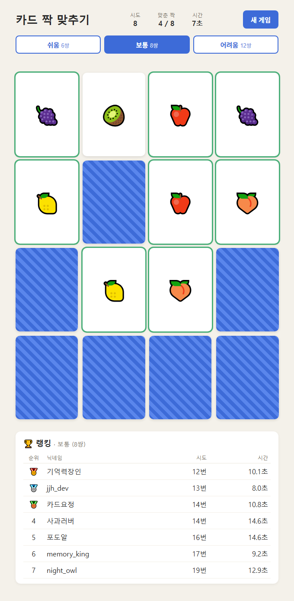
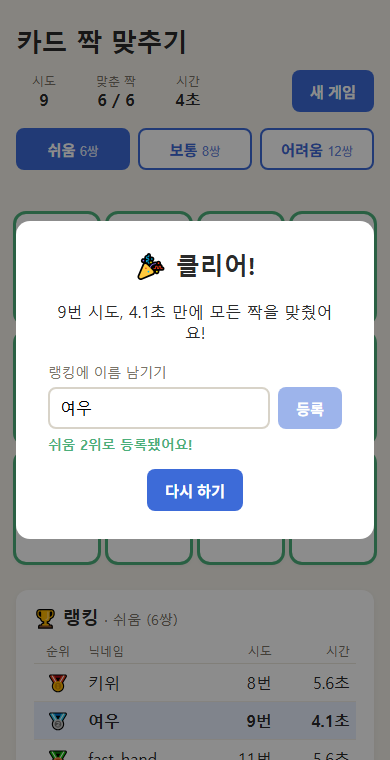

# 🃏 카드 짝 맞추기

[](https://github.com/qlqldks985/card-matching-game/actions/workflows/test.yml)

같은 그림의 카드 두 장을 찾아 뒤집는 기억력 게임입니다.
**카드 배치와 판정을 모두 서버가 맡기 때문에** 브라우저 개발자 도구로 정답을 미리 볼 수 없고, 랭킹 기록도 조작할 수 없습니다.

### 🎮 [지금 플레이하기 → card-matching-game-production.up.railway.app](https://card-matching-game-production.up.railway.app)

Railway에 배포했습니다 (Docker 이미지 + MySQL). `main`에 푸시하면 자동으로 다시 배포됩니다.

<p align="center">
  
  &nbsp;
  
</p>

## 주요 기능

- **난이도 3단계**: 쉬움 6쌍 / 보통 8쌍 / 어려움 12쌍. 마지막으로 고른 난이도를 기억합니다.
- **서버 판정**: 카드를 뒤집을 때마다 서버가 그림을 알려 주고, 짝이 맞는지 판정합니다.
- **랭킹**: 클리어하면 닉네임을 등록하고 몇 위인지 바로 확인할 수 있습니다. 난이도별 TOP 10이 나오고, 방금 등록한 내 기록은 강조됩니다.
- **모바일 지원**: 375px 폭에서도 가로 스크롤 없이 플레이할 수 있습니다.

## 기술 스택

| 구분 | 사용 기술 |
|---|---|
| Backend | Java 17, Spring Boot 4.1, Spring Web MVC, Spring Data JPA, Bean Validation |
| Database | MySQL 8.0, Flyway (테스트는 H2 MySQL 모드) |
| Frontend | HTML, CSS, JavaScript (프레임워크 없음) |
| Test | JUnit 5, AssertJ, MockMvc, `@DataJpaTest` |
| Infra | Docker (멀티 스테이지 빌드), Docker Compose, GitHub Actions, Railway (배포) |

## 설계 포인트

### 1. 정답은 서버만 안다
카드 배치는 서버 메모리의 `Game` 객체에만 있습니다. 클라이언트는 처음에 카드 **장 수**만 받고, 카드를 뒤집을 때마다 그 카드의 그림만 받습니다.
틀린 카드는 뒤집히는 애니메이션이 끝나면 화면(DOM)에서도 그림을 지워서, 개발자 도구로 이미 본 카드를 다시 확인할 수도 없습니다.

### 2. 기록은 서버가 판정한 값으로만 저장
기록 등록 API는 **닉네임만** 받습니다. 시도 횟수와 걸린 시간은 서버가 직접 센 값을 `Game`에서 꺼내 저장하므로, 요청을 조작해도 기록을 바꿀 수 없습니다. 끝나지 않은 게임은 등록할 수 없습니다.

### 3. 중복 등록은 두 번 막는다
- 먼저 `existsByGameId`로 이미 등록된 게임인지 확인합니다.
- 두 요청이 동시에 들어와 둘 다 확인을 통과하더라도, `game_id` **유니크 제약**에 걸려 하나만 저장됩니다. 이때 생기는 `DataIntegrityViolationException`은 409 Conflict로 바꿔서 응답합니다.

### 4. 순위 규칙과 인덱스
시도 횟수가 적을수록 → 같으면 시간이 짧을수록 → 그것도 같으면 먼저 등록한 순서로 순위를 매깁니다.
이 정렬 순서 그대로 `(pairs, moves, elapsed_millis)` 복합 인덱스를 걸었습니다. 내 순위는 "나보다 앞선 기록 수 + 1"을 `COUNT` 쿼리 하나로 구합니다.

### 5. 메모리 관리
진행 중인 게임은 `ConcurrentHashMap`에 보관합니다.
- 30분 동안 아무 카드도 뒤집지 않은 게임은 `@Scheduled` 작업이 1분마다 지웁니다.
- 기록을 등록한 게임은 그 즉시 지웁니다.

### 6. 시간을 다루는 코드도 테스트한다
`Game`이 `Clock`을 주입받습니다. 그래서 "30분 방치", "첫 카드부터 시간 재기" 같은 시간 관련 동작을 실제로 기다리지 않고 테스트 시계로 검증합니다.

### 7. 스키마는 Flyway로만 바꾼다
테이블은 `src/main/resources/db/migration`의 버전 붙은 SQL(`V1__...sql`)로만 만들고 바꿉니다. Hibernate는 `ddl-auto=validate`로 엔티티와 테이블이 맞는지 **검사만** 합니다. 그래서 운영 DB가 예상하지 못한 방식으로 바뀌지 않고, 스키마 변경 이력이 코드와 함께 남습니다.
- 테스트도 같은 SQL로 테이블을 만들고 `validate`를 거칩니다. 엔티티와 SQL이 어긋나면 CI에서 바로 실패합니다.
- Flyway를 넣기 전에 Hibernate가 이미 테이블을 만들어 둔 DB는 `baseline-on-migrate`로 V1을 기준점 삼아 이어서 관리합니다. 기존 DB와 빈 DB 두 경우 모두 실제 MySQL에서 확인했습니다.

### 8. 봇·매크로 탐지
정답은 서버만 알지만, 프로그램이 API를 직접 호출해 **완벽하게 기억하며 순식간에** 풀면 랭킹 1위를 쉽게 차지할 수 있습니다. 그래서 서버가 카드를 뒤집은 **시각만으로** 사람이 아닌 플레이를 가려냅니다(`PlayTiming`).

| 규칙 | 근거 | 의심 기준 |
|---|---|---|
| 틀린 직후 0.7초 안에 다음 카드 | 화면은 틀린 카드를 0.8초 동안 보여 주고 그동안 클릭을 막습니다. 정상 화면으로는 0.8초 안에 다음 요청이 서버에 도착할 수 없습니다. | 2회 이상 |
| 카드 사이 간격 0.08초 미만 | 사람이 마우스나 손가락으로 카드 두 장을 누를 수 없는 속도입니다. | 3회 이상 |

- 시각은 클라이언트가 보낸 값이 아니라 **서버 시계**로 잽니다. 그래서 조작할 수 없습니다.
- 네트워크 지연이나 기기 사정으로 정상 플레이가 걸리지 않도록 기준에 여유를 두고, 여러 번 어겼을 때만 의심합니다.
- 의심 기록은 지우지 않고 `flagged`로 표시해 **랭킹에서만 뺍니다**. 의심 이유는 DB와 서버 로그에만 남기고 응답에는 넣지 않습니다. 봇이 기준을 알아내 피해 가지 못하게 하기 위해서입니다.
- 랭킹 인덱스는 V2 마이그레이션에서 `(pairs, flagged, moves, elapsed_millis)`로 바꿨습니다.
- 실제 MySQL과 브라우저에서 확인했습니다. 화면에서 사람 속도(카드마다 0.25초)로 플레이한 기록은 정상 등록되고, API를 직접 호출한 봇과 화면에서 연타한 매크로는 랭킹에서 빠졌습니다.

**한계**: 사람처럼 일부러 천천히 누르도록 만든 봇은 시간 규칙만으로는 막을 수 없습니다. 이 규칙의 목적은 "순식간에 푸는 자동화"를 막고, 봇을 만드는 비용을 높이는 것입니다.

## 실행 방법

### 방법 1: Docker (추천)

Docker만 있으면 됩니다. MySQL도 컨테이너로 같이 뜹니다.

```bash
docker compose up --build
```

브라우저에서 http://localhost:8080 을 엽니다. 기록은 `db-data` 볼륨에 남기 때문에 컨테이너를 내렸다 올려도 유지됩니다.

- 앱은 MySQL 헬스체크가 통과한 뒤에 뜹니다 (`depends_on: service_healthy`).
- 앱은 root가 아닌 전용 DB 계정과 root가 아닌 OS 사용자로 실행됩니다.
- MySQL 포트는 호스트에 열지 않습니다. 그래서 PC에 설치된 MySQL과 충돌하지 않습니다.
- 비밀번호나 포트를 바꾸려면 `.env.example`을 `.env`로 복사해서 고칩니다.

### 방법 2: 직접 실행

**준비물**: JDK 17, MySQL 8.0. Maven은 설치하지 않아도 됩니다(포함된 `mvnw` 사용).

```powershell
# 1) MySQL 서비스 실행 (관리자 PowerShell)
Start-Service MySQL80

# 2) 프로젝트 폴더에서 서버 실행. cardgame 데이터베이스와 테이블은 자동으로 만들어집니다.
cd card-matching-game
$env:DB_PASSWORD="MySQL root 비밀번호"; .\mvnw spring-boot:run
```

브라우저에서 http://localhost:8080 을 엽니다. 테이블은 처음 실행할 때 Flyway가 만듭니다.

접속 정보는 아래 환경 변수로 바꿀 수 있습니다. 비밀번호를 코드에 넣지 않으려고 환경 변수를 씁니다.

| 환경 변수 | 기본값 |
|---|---|
| `DB_HOST` | `localhost` |
| `DB_PORT` | `3306` |
| `DB_NAME` | `cardgame` |
| `DB_USERNAME` | `root` |
| `DB_PASSWORD` | (빈 값) |

## API

| 메서드 | 경로 | 설명 |
|---|---|---|
| `POST` | `/api/games` | 새 게임 시작. 본문 `{"pairs": 8}` (2~12, 생략하면 8) |
| `POST` | `/api/games/{gameId}/flip` | 카드 한 장 뒤집기. 본문 `{"index": 3}` |
| `POST` | `/api/games/{gameId}/record` | 끝난 게임의 기록 등록. 본문 `{"nickname": "여우"}` |
| `GET` | `/api/rankings?pairs=8&limit=10` | 난이도별 랭킹 (`limit` 1~50) |

<details>
<summary>응답 예시</summary>

`POST /api/games/{gameId}/flip`: 두 번째 카드를 뒤집어 짝이 맞은 경우
```json
{
  "index": 5, "symbol": "🍎", "pairedWith": 2, "matched": true,
  "moves": 7, "matchedPairs": 3, "totalPairs": 8,
  "finished": false, "elapsedSeconds": 12, "elapsedMillis": 12345
}
```
첫 번째 카드일 때는 `pairedWith`와 `matched`가 `null`입니다.

`POST /api/games/{gameId}/record` → `201 Created`
```json
{ "id": 42, "rank": 3, "nickname": "여우", "pairs": 8, "moves": 14, "elapsedMillis": 10792, "playedAt": "2026-11-18T06:51:08Z", "excluded": false }
```
봇 의심으로 랭킹에서 빠지면 `"rank": null, "excluded": true` 입니다 (이유는 알려 주지 않습니다).

오류는 `{"message": "..."}` 형태로 응답합니다.

| 상태 코드 | 경우 |
|---|---|
| 400 | 잘못된 입력, 끝나지 않은 게임을 등록하려 할 때 |
| 404 | 없는 게임 |
| 409 | 이미 기록을 등록한 게임 |

</details>

## 프로젝트 구조

```
src/main/java/com/jjh/cardgame
├── game                   # 게임 진행 (메모리)
│   ├── domain             # Game, Card, FlipResult: 규칙과 판정
│   ├── dto
│   ├── service            # GameService: 게임 보관, 방치된 게임 정리
│   └── web                # GameController, ApiExceptionHandler
└── ranking                # 기록 저장과 랭킹 (MySQL)
    ├── domain             # GameRecord 엔티티, GameRecordRepository
    ├── dto
    ├── service            # RankingService
    └── web                # RankingController
src/main/resources/static        # index.html, css, js
src/main/resources/db/migration  # Flyway SQL (V1__create_game_record.sql)
```

## 테스트

```powershell
.\mvnw test
```

MySQL 없이 H2(MySQL 호환 모드)로 실행되며, 테스트는 27개입니다. GitHub Actions가 푸시할 때마다 자동으로 실행합니다.

| 테스트 | 검증하는 내용 |
|---|---|
| `GameTest` | 짝 판정, 게임 종료, 잘못된 위치나 이미 맞춘 카드 거부 |
| `GameTimingTest` | 시간은 첫 카드부터 측정, 방치 판정 |
| `GameServiceCleanupTest` | 방치된 게임만 지움 |
| `PlayTimingTest` | 봇 탐지 기준값 경계, 사람 속도로 풀면 통과하고 곧바로 풀면 걸림 |
| `GameRecordRepositoryTest` | 순위 정렬(동점 처리 포함), 순위 계산 쿼리, 조회 개수 제한, 봇 의심 기록 제외 |
| `RankingApiTest` | 등록부터 랭킹 조회까지 전체 흐름, 중복 409, 끝나지 않은 게임 400, 닉네임 검증, 난이도별 분리, 봇 기록은 저장하되 랭킹에서 제외(이유는 응답에 없음) |

테스트에서는 그림을 미리 알 수 없으므로, `GameSolver`가 사람처럼 본 카드를 기억하면서 게임을 끝까지 풉니다.

## 앞으로 할 것

- [ ] 점수 시스템 (연속으로 맞히면 보너스)
- [ ] 새로고침해도 이어 하기 (`GET /api/games/{id}`)
- [ ] 로그인과 내 기록 보기
- [ ] WebSocket 1:1 대전
